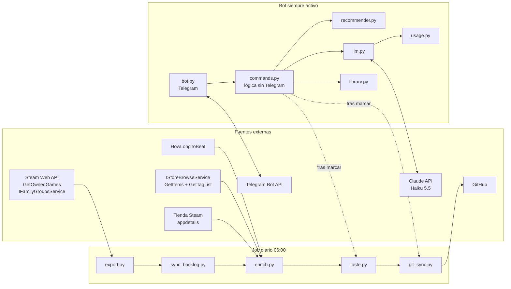
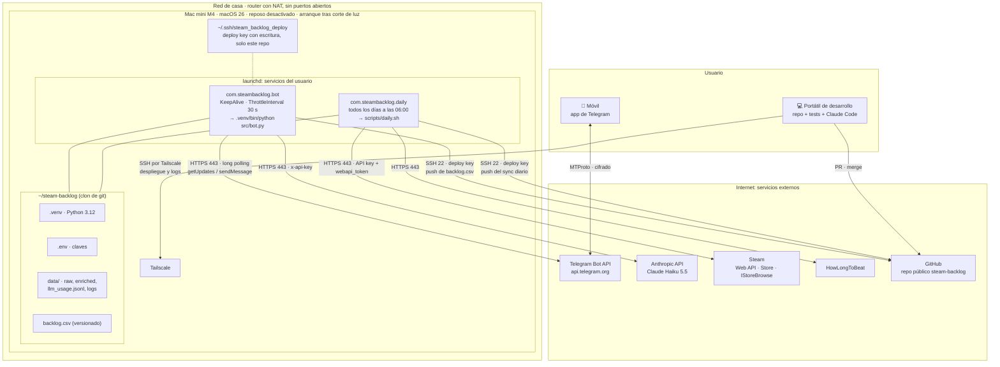
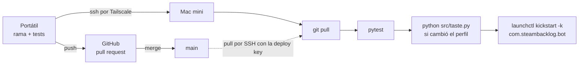
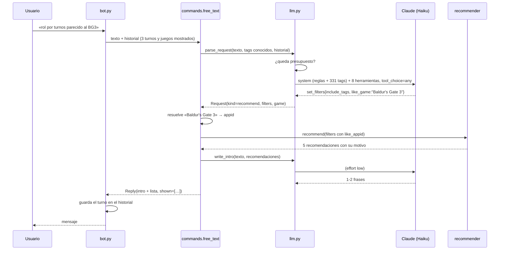

# steam-backlog: solución, arquitectura y algoritmos

Este documento explica qué hace el sistema, cómo está montado y cómo decide qué
recomendar. Para instalarlo y usarlo, mira el [README](../README.md). El diseño
original está en
[docs/superpowers/specs/2026-11-07-bot-recomendador-design.md](superpowers/specs/2026-11-07-bot-recomendador-design.md).

---

## 1. La solución

### El problema

Una biblioteca de Steam con cientos de juegos, entre propios y compartidos por
Family Sharing (unos 400 en el caso real). Muchos no se han empezado y otros se
dejaron a medias. Cuando hay un rato para jugar, cuesta elegir.

### Qué hace

1. **Inventario.** Un job diario exporta la biblioteca, la propia y la familiar,
   y la mantiene en `backlog.csv` con un estado por juego (`pendiente`,
   `jugando`, `terminado`, `abandonado` o `descartado`).
2. **Enriquecimiento.** Por cada juego obtiene sus géneros, sus tags con peso,
   sus reseñas y su duración en HowLongToBeat.
3. **Perfil de gusto.** Cruza las horas jugadas con los tags de cada juego y lo
   que se ha terminado o dejado. Con eso puntúa cada pendiente y le asigna un
   motivo («porque jugaste X»), al estilo de Netflix.
4. **Bot de Telegram.** Se le habla por comandos o con texto libre: «algo
   tranquilo», «rol por turnos parecido al Baldur's Gate 3», «¿esos los tengo?»,
   «me he pasado el Awakened». Recomienda, enseña fichas y cambia estados.

### Principios de diseño

| Principio | Cómo se aplica |
|---|---|
| **El LLM no elige juegos** | Claude solo traduce el texto libre a una petición estructurada (filtros, una ficha, cambios de estado) y escribe una frase de introducción. Qué juegos salen y en qué orden lo decide código determinista y testeable. Así no puede inventarse juegos que no tienes. |
| **Sin IA también funciona** | Si la API falla o se acaba el presupuesto, el bot responde con las recomendaciones de siempre. Todos los comandos con `/` funcionan sin IA. |
| **Privacidad por diseño** | En git solo se versiona `backlog.csv` (appid, nombre, estado, prioridad y notas), sin SteamIDs ni horas. Las claves van en `.env` y los datos crudos en `data/`, y ambos están en `.gitignore`. |
| **Coste acotado** | Se registra lo que gasta de verdad cada llamada, hay un tope mensual con aviso al 80 % y corte al 100 %, y se usa Haiku. Una consulta en texto libre cuesta unos 0,0007 $. |
| **Sin infraestructura expuesta** | El bot usa long polling: no abre puertos. Solo atiende a un `chat_id` y el resto queda registrado en el log. |
| **Un solo usuario y un solo proceso** | Es un monolito modular en un Mac mini, sin base de datos. El estado vive en ficheros (CSV y JSON) que se escriben de forma atómica. |

---

## 2. Arquitectura

### Vista general



### Módulos

| Módulo | Responsabilidad | Depende de |
|---|---|---|
| `src/config.py` | Rutas del proyecto y carga de `.env` | — |
| `src/export.py` | Steam API → `data/raw/steam_library.{csv,json}` (solo librería estándar) | Steam |
| `src/sync_backlog.py` | Añade los juegos nuevos a `backlog.csv` como `pendiente`; nunca toca las filas que ya existen | — |
| `src/enrich_sources.py` | Clientes HTTP de cada fuente, con `parse_*` puros (se prueban con respuestas grabadas) y `fetch_*` con límite de ritmo | tienda, IStoreBrowse, HLTB |
| `src/enrich.py` | Caché por appid en `games.json`; solo pide lo que falta | enrich_sources |
| `src/library.py` | Lee y escribe `backlog.csv` (escritura atómica), horas jugadas y la vista de solo lectura de la biblioteca | config |
| `src/taste.py` | Perfil de gusto y puntuación de los pendientes → `profile.json`, `scores.json` | library |
| `src/recommender.py` | Filtros, ranking, variedad y filas «Netflix». Puro: no sabe nada de Telegram ni del LLM | taste (vectores) |
| `src/llm.py` | Texto libre → `Request` (con tool use) e intro breve; comprueba el presupuesto antes de cada llamada | anthropic, usage |
| `src/usage.py` | Registro JSONL del uso real, precios, agregado mensual y nivel de presupuesto | — |
| `src/commands.py` | Un `Reply` por comando, más el texto libre, el marcado y el repaso. Sin Telegram, así se prueba con datos falsos | todo lo anterior |
| `src/bot.py` | Adaptador de Telegram: handlers, botones, memoria del chat, errores y menú | python-telegram-bot, commands |
| `src/git_sync.py` | `commit` + `pull --rebase` + `push` de `backlog.csv`, con un candado de fichero | git |
| `src/images.py` | URL de cada imagen de un juego y caché local en `data/images/` (para la web) | config |
| `src/notify.py` | Avisos del job diario por Telegram (hoy: el token de la familiar caducó) | config |

El reparto sigue una regla: **la lógica no conoce el canal**. `commands.py`
devuelve `Reply(text, buttons, shown, columns, photos)` y `bot.py` lo traduce a
Telegram. Una futura web reutilizaría `commands`, `recommender` y `taste` tal
cual.

### Datos

```
backlog.csv                      ← VERSIONADO. appid, name, estado, prioridad, notas
.env                             ← claves (ignorado)
data/                            ← todo ignorado
├── raw/steam_library.csv|json   ← export: origen, horas, fechas y dueños (SteamIDs)
├── enriched/
│   ├── games.json               ← por appid: géneros, categorías, tags{nombre: peso},
│   │                              reseñas, hltb_main/extra, images{tipo: URL},
│   │                              fuentes que faltan
│   ├── playtime_cache.json      ← horas de juegos que desaparecen del export
│   ├── profile.json             ← vector de gusto {tag: peso}
│   └── scores.json              ← por pendiente: score, sim, quality, ancla, tags
│                                  compartidos y horas jugadas
├── raw/export_status.json       ← si el último export pudo leer la biblioteca familiar
├── images/<appid>/<tipo>.jpg    ← caché local de imágenes de la tienda (para la web)
├── llm_usage.jsonl              ← una línea por llamada a Claude con tokens y coste
├── logs/{daily,bot}.log
└── .git.lock                    ← candado entre el job y el bot
```

Las escrituras usan un fichero temporal y `os.replace`
(`library._atomic_write_text`), así que un lector nunca ve un JSON a medias. El
bot vuelve a leer los ficheros con cada mensaje (`load_store()`), de modo que
recoge lo que ha calculado el job sin reiniciarse.

### Infraestructura

Todo el backend corre en un **Mac mini (Apple M4, macOS 26)** conectado a la
red de casa. No hay nube propia, contenedores ni base de datos. El Mac **no
acepta ninguna conexión entrante desde internet**: todas las conexiones las
abre él hacia fuera, por HTTPS o por SSH en el caso de GitHub. El acceso de
administración entra por la red privada de Tailscale.



#### Conexiones

| Origen → destino | Protocolo | Autenticación | Para qué |
|---|---|---|---|
| Bot → Telegram | HTTPS 443, long polling | token del bot (`.env`) | recibir mensajes y botones, y responder |
| Bot → Anthropic | HTTPS 443 | `ANTHROPIC_API_KEY` (`.env`) | interpretar el texto libre y escribir la intro |
| Job → Steam | HTTPS 443 | `STEAM_API_KEY` + `STEAM_WEBAPI_TOKEN` (caduca en ~24 h) | export de la biblioteca propia y familiar; tags, reseñas y géneros |
| Job → HowLongToBeat | HTTPS 443 | — | duraciones |
| Bot y job → GitHub | SSH 22 | deploy key con escritura, limitada a este repo | push y pull de `backlog.csv` |
| Portátil → Mac | SSH dentro de la red privada de Tailscale | clave SSH del usuario | despliegue, logs, operación |
| Móvil → Telegram | app de Telegram | cuenta de Telegram | conversar con el bot; solo responde a `TELEGRAM_ALLOWED_CHAT_ID` |

Gracias al long polling no hace falta webhook, dominio ni certificado: el
bot pregunta a Telegram si hay mensajes nuevos.

#### Procesos y disponibilidad

- **Dos servicios `launchd` de usuario**, instalados con `ops/install_launchd.sh`
  a partir de `ops/launchd/*.plist`. Los dos escriben su salida en
  `data/logs/{bot,daily}.log`.
  - El **bot** arranca con `RunAtLoad` y `KeepAlive`: si el proceso muere,
    launchd lo vuelve a lanzar, con al menos 30 s entre intentos. Responde a
    cada mensaje en un hilo (`asyncio.to_thread`) para no bloquear el polling.
  - El **job diario** ejecuta `export → sync_backlog → enrich → taste →
    git_sync` y termina. Si falla el export, sigue con los datos del día
    anterior.
- **Energía.** El reposo del sistema está desactivado y el Mac arranca solo
  tras un corte de luz. Con eso, el bot vuelve a estar disponible sin
  intervención.
- **Concurrencia.** El job y el bot comparten disco y repo. Las escrituras son
  atómicas y git se serializa con un candado (`data/.git.lock`, `fcntl.flock`).
- **Instancia única.** Solo puede haber **un** proceso del bot a la vez, porque
  Telegram rechaza dos sesiones de polling con el mismo token. Para probar en
  el portátil hay que parar antes el servicio del Mac.
- **Huella.** Un proceso de Python siempre activo y menos de 1 MB en `data/`.
  Los únicos costes de terceros son las llamadas a Claude, que tienen tope
  mensual.

#### Despliegue



No hay CI/CD automático: el despliegue es manual y lleva cuatro comandos.
Que el bot arranque se comprueba en `data/logs/bot.log` («Bot arrancado; solo
respondo al chat …») y con `launchctl list | grep steambacklog`.

#### Estado, copias y recuperación

| Dato | Dónde | Si se pierde |
|---|---|---|
| `backlog.csv` (estados) | repo en GitHub, con historial | es lo único que no se puede regenerar, y git ya es la copia |
| `data/raw`, `data/enriched` | solo en el Mac | se regeneran con `scripts/daily.sh` (~15 min, por los límites de ritmo) |
| `playtime_cache.json` | solo en el Mac | se pierden las horas de juegos que ya no salen en el export |
| `llm_usage.jsonl` | solo en el Mac | se pierde el contador de gasto del mes |
| `.env` | solo en el Mac (y en el portátil para desarrollo) | hay que volver a generar las claves |

Para montar el sistema en otra máquina basta con clonar el repo, crear `.venv`,
copiar `.env`, añadir una deploy key, ejecutar `scripts/daily.sh` y
`ops/install_launchd.sh`. Los pasos están en el README.

#### Git como sincronización

El job y el bot hacen push de `backlog.csv`, así que los estados también
pueden editarse desde otro equipo. Antes del push se hace `pull --rebase`; si
hay conflicto, el commit se queda en local y se avisa en el log.

### Secuencia: un mensaje de texto libre



---

## 3. Algoritmos

### 3.1 Export y biblioteca familiar

- Los juegos propios salen de `IPlayerService/GetOwnedGames`, con horas
  exactas y última partida.
- Los compartidos salen de `IFamilyGroupsService/GetSharedLibraryApps`, una API
  no documentada que necesita un `webapi_token` de la tienda que caduca en unas
  24 h. De ahí vienen el origen (`propio` o `compartido`), los dueños y la
  **fecha de adquisición** (`rt_time_acquired`).
- Si un juego aparece en las dos fuentes, mandan las horas de `GetOwnedGames` y
  se añade la fecha de adquisición de la familiar.
- Las fechas anteriores al lanzamiento de Steam (2003-09-12) se descartan: la
  API a veces devuelve `1970-01-01`.

### 3.2 Enriquecimiento

| Fuente | Datos | Ritmo |
|---|---|---|
| `store.steampowered.com/api/appdetails` (`l=spanish`) | géneros, categorías («Un jugador»…), metacritic | 1 petición cada 1,5 s |
| `IStoreBrowseService/GetItems` + `GetTagList` | hasta 20 tags **con peso** y en español, reseñas (total y % positivo) e **imágenes** (`include_assets`) | 1 por segundo |
| HowLongToBeat (`howlongtobeatpy`) | horas de la historia principal y con extras | 1 por segundo |

- Hay una **caché incremental**: cada entrada guarda en `missing` las fuentes
  que fallaron, y solo se repiten esas. Un «no encontrado» es un resultado
  válido y no se vuelve a pedir.
- Si una fuente responde con un **429**, se deja de consultar durante esa
  ejecución y se reintenta al día siguiente.
- En **HLTB** se limpian los ™ ® © del nombre, se busca y se acepta el mejor
  resultado solo si su similitud es ≥ 0,6. Si no, la duración se queda
  desconocida, que es mejor que una duración equivocada.
- **Imágenes.** `GetItems` devuelve los ficheros de cada juego y un patrón
  `asset_url_format` con la versión (`?t=…`). Se guardan como URLs absolutas de
  la CDN de Steam (`shared.akamai.steamstatic.com`): `header` 460×215, `capsule`
  616×353, `small` 231×87, `portrait` 600×900, `hero` 1920×620 e `icon` 32×32.
  Las entradas de caché anteriores a las imágenes vuelven a pedir solo `items`.

### 3.3 Perfil de gusto (`taste.py`)

**Vector de un juego.** Se toman los 10 tags de más peso y se normalizan
respecto al primero, que vale 1. Si el juego no tiene tags, se usan sus géneros
con peso 1.

**IDF.** Un tag presente en media biblioteca (Acción, Aventura) dice poco del
gusto; uno raro (Agricultura, Roguelike) dice mucho. Cada peso se multiplica
por:

```
idf(t) = ln((1 + N) / (1 + df(t))) + 1
```

`N` es el número de juegos con vector y `df(t)` el número de juegos en los que
aparece `t`. El `+1` final garantiza que ningún tag desaparezca del todo.

**Peso de cada juego jugado:**

```
w(j) = ln(1 + horas_j) × (1,5 si se jugó en los últimos 180 días, si no 1) × E(estado_j)

E: terminado 1,5 · jugando 1,2 · pendiente 1 · abandonado −0,5 · descartado −0,5
```

- El **logaritmo** evita que un juego de 500 h (un multijugador eterno) domine
  el perfil: 500 h pesan unas 2,6 veces lo que 10 h, no 50.
- La **recencia** hace que el perfil siga los gustos actuales.
- El **estado** cierra el ciclo: lo que se dice en el bot («me aburre») resta.
  Por eso el perfil puede tener componentes negativas.

**Perfil:** `P = normalizar_L2( Σ_j w(j) · v(j) )` sobre los juegos con horas.

### 3.4 Puntuación de los pendientes

Para cada juego del backlog en `pendiente`:

```
sim     = cos(P, v(juego))
quality = (positivas + 0,75·50) / (total + 50)     ← media bayesiana con prior del 75 %
score   = 0,7·sim + 0,3·quality
```

- La **media bayesiana** hace que un juego con 4 reseñas al 100 % no adelante a
  uno con 100 000 al 95 %. Sin reseñas se queda en 0,75.
- **Ancla («porque jugaste X»)**: el juego jugado que maximiza
  `cos(v(jugado), v(juego)) × ln(1 + horas_jugado)`. Quedan fuera los marcados
  como `abandonado` o `descartado`: no tendría sentido recomendar algo «porque
  jugaste» un juego que no te gustó. Se muestran los 2 tags compartidos de más
  peso conjunto.
- Se guarda `played_hours` para que el recomendador pueda excluir lo ya empezado.

### 3.5 Recomendación (`recommender.py`)

**Candidatos.** Juegos en `pendiente`, con puntuación y con **menos de 2 h
jugadas**. El backlog nació con todo en «pendiente», así que más de 100 juegos
muy jugados siguen ahí y no deben salir como novedad. `/repasar` sirve para
clasificarlos.

**¿Casa un término con un juego?** La función `tag_share(juego, término)` busca
el término al principio de palabra, sin tildes ni mayúsculas. «rogue» casa con
«Roguelike de acción» y «rol» no casa con «Control». Devuelve cuánto pesa ese
tag respecto al principal del juego (0 a 1). Un género de la tienda que casa
cuenta como 0,5. Un término **casa** si `tag_share ≥ 0,25`, es decir, si es un
rasgo relevante del juego y no un tag residual.

**Filtros:**

| Filtro | Regla |
|---|---|
| `max_hours` | Duración total en HLTB ≤ máximo. Si la duración es desconocida, no pasa. Los juegos **solo multijugador** (sin la categoría «Un jugador») tampoco pasan, porque su duración en HLTB no significa nada. |
| `include_tags` | Casa al menos uno |
| `exclude_tags` | No casa ninguno |
| `min_positive`, `min_reviews` | Umbrales sobre las reseñas |
| `appids` | Solo esos juegos. El texto libre lo usa para «de la biblioteca familiar» o «de los míos» |

**Orden:**

| Caso | Clave de orden (de mayor a menor) |
|---|---|
| Sin tags ni referencia | `score` |
| Con tags pedidos | `(nº de tags que casa, 0,5·score + 0,5·relevancia)`. Primero los que cumplen más tags; dentro de cada grupo, una mezcla de gusto y encaje. |
| «Parecido a X» | `base = 0,7·cos(v(X), v(juego)) + 0,3·score`, con vectores IDF |
| «Parecido a X» con tags | `0,85·base + 0,15·relevancia`. Manda la similitud con X y los tags solo filtran y matizan. |

`relevancia` es la media de `tag_share` de los términos pedidos, contando 0 los
que no llegan a 0,25.

**Orden explícito** (`sort`). «El mejor valorado» ordena por la calidad
bayesiana y «lo más corto» por la duración en HLTB, con las desconocidas al
final. Si además hay tags o «parecido a X», primero se eligen los 15 más
relevantes y solo esos se reordenan. Así, «¿y más cortos?» tras «algo como
Hades» devuelve roguelikes cortos y no el juego más corto de la biblioteca.

**Variedad.** No se repite el mismo ancla («porque jugaste X» dos veces) hasta
agotar las alternativas. Con «parecido a» no se aplica, porque el motivo ya es
el juego de referencia.

**Filas de `/top`.** «Para ti», «Sesión corta (≤ 5 h)» y «Joyas valoradas
(≥ 90 %, ≥ 500 reseñas)». Cada fila excluye lo que ya salió en las anteriores.

### 3.6 Texto libre con Claude (`llm.py`)

Se hace una llamada de **parseo** con `tool_choice: any`, que obliga a usar una
de las ocho herramientas y no a contestar en prosa:

| Herramienta | Cuándo | Resultado |
|---|---|---|
| `set_filters` | Qué jugar, géneros, duración, «parecido a X», origen (`source`), orden (`sort`) | `Request(kind="recommend", filters, game=X, source)` |
| `game_info` | Pregunta por uno o varios juegos concretos | una ficha por juego (hasta 5) |
| `review_games` | «Repasemos los de Sherlock Holmes» | repaso con botones, filtrado por nombre |
| `recent_games` | Qué ha llegado a la biblioteca hace poco | lista por fecha de adquisición |
| `mark_games` | «Me he pasado X», «Y me aburre», «márcalos» | cambios de estado que se confirman con un botón |
| `last_results` | «¿Esos los tengo?», «¿cuánto duran?» | origen, duración y horas de lo último mostrado |
| `game_status` | «Dame sus estados», «¿cómo tengo los de Sherlock?» | estado de los juegos de un nombre o saga; sin nombre (o si no casa), los últimos mostrados o tocados con botones |
| `bot_help` | Saludos, «qué puedes hacer», «cuánto llevo gastado» | la ayuda o `/coste` |

- **Contexto.** El prompt de sistema incluye **todos** los tags conocidos (331),
  para que el modelo copie nombres reales y no los invente. El mensaje del
  usuario va acompañado de los 3 últimos turnos, cada uno con los juegos que
  mostró el bot. Con eso se resuelven «¿y de estrategia?», «los dos últimos» o
  «fecha de compra me refiero». Los botones también dejan rastro: al terminar un
  repaso o confirmar un marcado, el turno se guarda con los juegos afectados.
- **Validación de lo que devuelve.** Los tags que no casan con la lista
  conocida se descartan. `limit` se acota a 1-5, `recent` a 1-20 y
  `min_positive` a 0-1. Los estados deben ser válidos y se admiten como mucho 5
  marcas, porque el `callback_data` de Telegram tiene un límite de 64 bytes:
  `marks:350640=t,1949030=t,…`.
- **Resolución de nombres.** Lo que nombra el modelo se busca primero entre los
  juegos que se acaban de mostrar (nombre exacto o contenido) y después en todo
  el backlog.
- **Intro.** Una segunda llamada con `effort: low` escribe 1-2 frases sobre la
  lista ya elegida. Recibe la duración y los tags de cada juego para no
  inventar, y se le quitan las viñetas si intenta repetir la lista.
- **Confirmación.** Cambiar estados siempre pide confirmación con un botón. El
  LLM propone y el usuario confirma.

### 3.7 Búsqueda de nombres

Se aplica en orden y se para en el primer paso que encuentra algo:

1. Coincidencia exacta, sin tildes ni mayúsculas.
2. Subcadena: «hades» encuentra Hades y Hades II.
3. **Por palabras**: cada palabra de 3 o más letras de la consulta se parece
   (difflib ≥ 0,8) a alguna del nombre. «chapters one» encuentra «Sherlock
   Holmes Chapter One» y «devils daughter» encuentra «The Devil's Daughter».
4. Parecido del nombre completo (difflib ≥ 0,6).

### 3.8 Repaso (`/repasar`)

- **Qué entra.** Juegos en `pendiente` con 2 h o más jugadas. Primero los
  jugados más recientemente, que son los más fáciles de recordar; en caso de
  empate, los de más horas. Con un nombre o saga (`/repasar sherlock holmes` o
  la herramienta `review_games`) entran todos los pendientes que casen,
  empezados o no.
- **Cómo se clasifican.** Cada botón (Terminado, Jugando, Abandonado,
  Descartado, Saltar) escribe en local y pasa al siguiente editando el mismo
  mensaje.
- **Cuándo se sube.** Hay un **único commit** al pulsar Parar o al acabar, en
  vez de uno por botón. Si se deja a medias, lo sube el job diario.
- **Dobles toques.** Un segundo toque sobre un juego ya atendido no cambia nada,
  y un botón de un repaso ya terminado responde «Este repaso ya terminó». Al
  acabar se listan los cambios. Si al pedir un repaso por nombre no queda nada
  pendiente, se muestra cómo están esos juegos.
- **Perfil.** Al terminar se llama a `taste.refresh()`, y el perfil incorpora
  los nuevos estados en ese momento.

### 3.9 Imágenes y presentación

**En el bot (`bot.deliver`, `bot.replace`).** Cada `Reply` puede llevar
`photos`, que son pares (URL, pie). Telegram descarga las imágenes de la CDN de
Steam, así que el bot no guarda nada:

| Respuesta | Cómo se ve |
|---|---|
| Recomendaciones, `/top`, `/parecidos` | álbum con la cabecera de cada juego («1. Nombre» de pie, hasta 10) y debajo la lista con motivos y enlaces |
| Ficha de un juego (`/juego`) | la cabecera con la ficha como pie, en un solo mensaje (si cabe en 1 024 caracteres) |
| Varias fichas | álbum y, debajo, las fichas |
| Repaso | la cabecera del juego con la ficha y los botones; al pulsar, la foto se cambia en el mismo mensaje (`edit_media`) |
| Estados y cambios | emoji por estado: ⏳ pendiente · 🎮 jugando · ✅ terminado · 💤 abandonado · 🚫 descartado |

Si Telegram rechaza una imagen, se envía solo el texto: las imágenes adornan,
nunca impiden responder. Si un botón cambia el tipo de mensaje (de foto a
texto al acabar un repaso), el mensaje se borra y se envía de nuevo.

**Para la web.** `src/images.py` descarga a `data/images/<appid>/<tipo>.jpg`
las que falten, por defecto `header`, `portrait` e `icon`, desde el job diario
y a una cada 0,2 s. La web puede servirlas en local, sin depender de la CDN ni
filtrar a Steam qué juegos se miran. Uso previsto de cada tipo:

| Tipo | Uso en la web |
|---|---|
| `portrait` 600×900 | rejilla del backlog, como la biblioteca de Steam |
| `header` 460×215 | tarjetas de recomendación y resultados |
| `hero` 1920×620 | fondo de la ficha de un juego |
| `capsule` 616×353 | destacados («Para ti») |
| `icon` 32×32 | listas compactas, historial y repaso |

Las imágenes son de Steam y de cada editora. Se usan para mostrar tu propia
biblioteca y viven en `data/` (ignorado), nunca en el repositorio público.

### 3.10 Control de costes (`usage.py`)

- **Coste por llamada**, a partir de su `usage` real:

  ```
  coste = (in·p_in + out·p_out + cache_read·p_in·0,1 + cache_5m·p_in·1,25 + cache_1h·p_in·2) / 10⁶
  ```

  Para Haiku 5.5, `p_in = 0,10 $` y `p_out = 0,50 $` por millón de tokens. Si
  el prompt supera los 100 000 tokens, se aplica la tarifa larga (0,50 $ y
  2,50 $).
- **Modelos sin precio.** Solo tienen precio los modelos de la tabla. Una
  llamada con otro modelo se cuenta como «sin precio» y no se estima.
- **Presupuesto.** `LLM_MONTHLY_BUDGET_USD` vale 1 $ por defecto; 0 significa
  sin tope. Al 80 % se avisa en el log. Al 100 % (`BudgetExceeded`) no se llama
  a la API hasta el mes siguiente y el bot responde sin IA.
- **Consumo de referencia:** unas 2 700 tokens de entrada por llamada, sobre
  todo por la lista de tags, y unos 0,0035 $ por cada 10 llamadas.

---

## 4. Fallos y degradación

| Fallo | Comportamiento |
|---|---|
| Caduca el token de la familiar (401) | El export conserva del export anterior los juegos compartidos y las fechas de compra, que solo da esa API. Las horas de los compartidos se quedan como estaban hasta renovar el token. `notify.py` avisa por Telegram con las instrucciones para renovarlo |
| Una imagen no carga en Telegram | Se envía la respuesta sin imágenes |
| Una fuente del enriquecimiento cae o devuelve 429 | La fuente queda en `missing` y se reintenta al día siguiente |
| Claude no responde, no hay clave o se agota el presupuesto | Recomendaciones «Para ti» con un aviso. Los comandos con `/` no se ven afectados |
| Falla solo la intro | Se envía la lista sin la frase |
| Falla el push a GitHub | El cambio se queda en local («queda en local») y lo sube el siguiente `git_sync` |
| Cortes de red con Telegram | Una línea de aviso en el log; la librería reintenta sola |
| Doble toque en un botón | No se repite el cambio; se ignora el `BadRequest: message is not modified` |
| Falla el recálculo del perfil tras marcar | El marcado se completa igualmente; el log guarda la traza y el job diario lo recalcula |

---

## 5. Seguridad y privacidad

- El repositorio es **público**: en git solo está `backlog.csv`. El
  `.gitignore` ignora `*.json` y `*.csv` salvo `backlog.csv` y las fixtures de
  tests.
- Los SteamIDs de los dueños solo existen en `data/raw/`. `read_library()` los
  excluye a propósito de la vista que usa el bot.
- Los `TELEGRAM_*`, `ANTHROPIC_API_KEY` y `STEAM_*` van en `.env`. El logger de
  `httpx` se sube a WARNING porque las URLs de Telegram llevan el token del bot.
- El bot solo responde a `TELEGRAM_ALLOWED_CHAT_ID`, tanto a mensajes como a
  botones. Sin ese valor arranca en modo configuración y no responde a nadie.

---

## 6. Pruebas

`pytest` (unos 190 tests) sin red:

- **Fuentes:** respuestas grabadas en `tests/fixtures/`.
- **LLM:** un cliente falso que devuelve llamadas a herramientas. Se comprueban
  las herramientas enviadas, el contexto, la validación y el registro de uso.
- **Comandos y texto libre:** un `Store` en memoria y un módulo `llm` falso.
- **Bot:** registro de handlers, filtros de chat, botones, memoria, gestión de
  errores, y envío y edición de fotos, con `Update` sintéticos y un bot falso.
- **Escrituras:** `backlog.csv` en `tmp_path`, con un `sync` y un `refresh`
  inyectados para que ningún test toque git ni los datos reales.

La calidad de las recomendaciones se revisa con conversaciones reales. El log
del bot registra cada mensaje, la petición que extrajo Claude y los juegos
devueltos. Además se pasa una batería de frases típicas («dame sus estados»,
«¿y más cortos?», «de la biblioteca familiar», «hola»…) contra Haiku real
antes de cada entrega.

---

## 7. Limitaciones conocidas y siguientes pasos

- Un `/marcar` justo mientras corre el job de las 06:00 puede perderse.
- El token de la biblioteca familiar caduca cada día, y renovarlo es manual
  (el bot avisa).
- La memoria de la conversación vive en RAM y se pierde al reiniciar el bot.
- Las opiniones («me gustan») no se guardan como tales: solo influyen a través
  del estado. Podrían guardarse en la columna `notas`.
- Las duraciones de HLTB faltan en algunos juegos (aparecen como «? h») y esos
  juegos no pasan el filtro de duración.
- Una interfaz web reutilizaría `commands`, `recommender`, `taste` e `images` sin
  cambios. Las imágenes ya están en caché local (ver 3.9).
